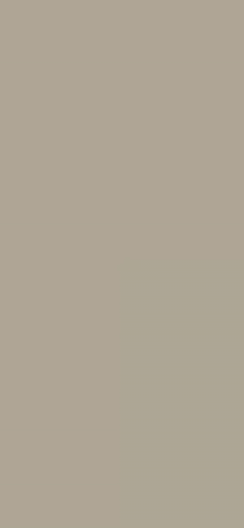
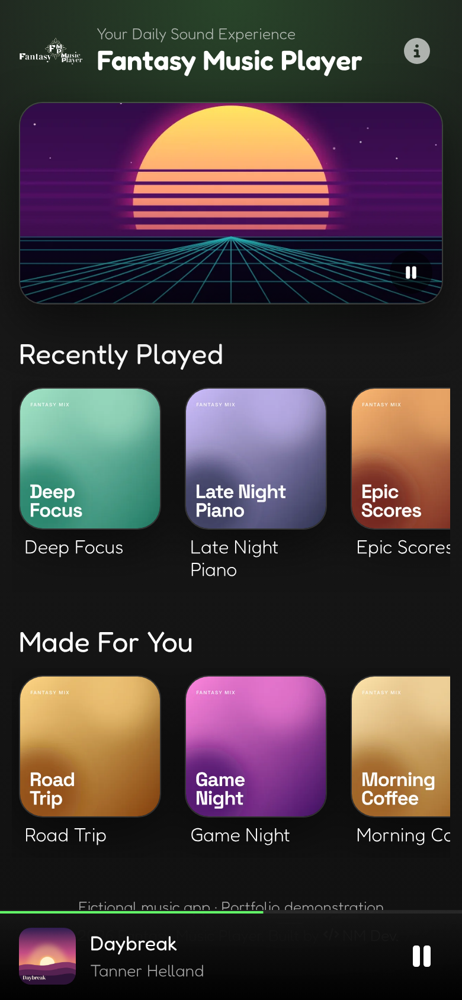
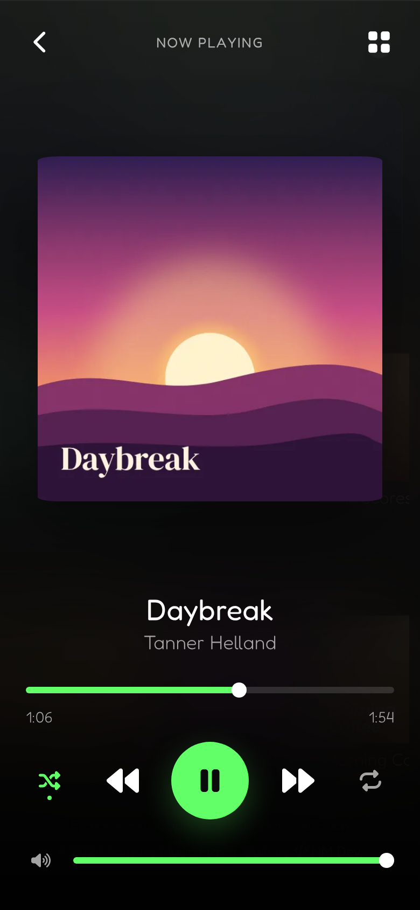
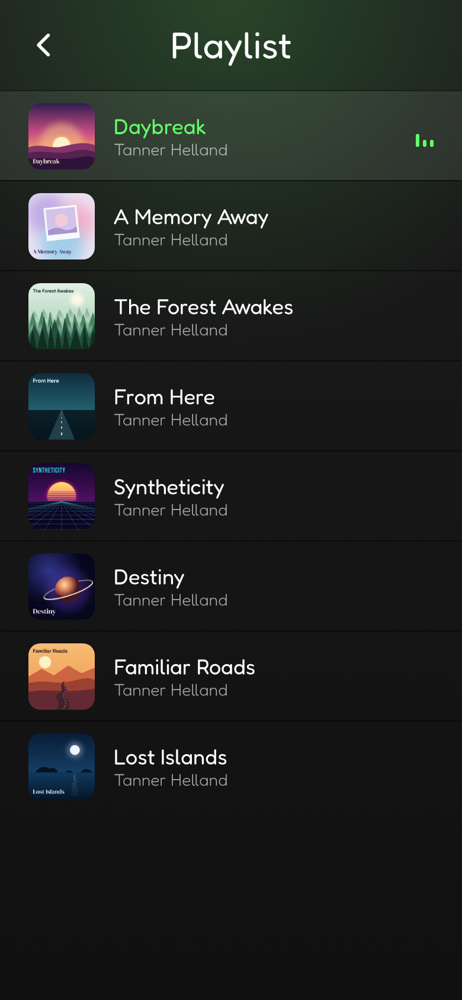
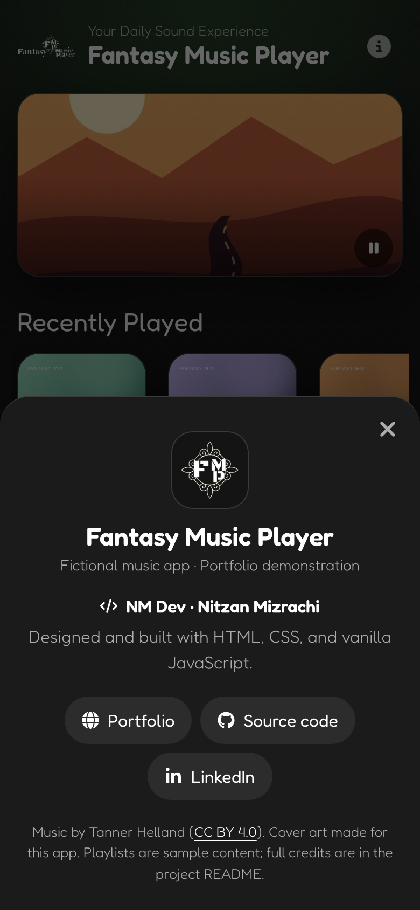
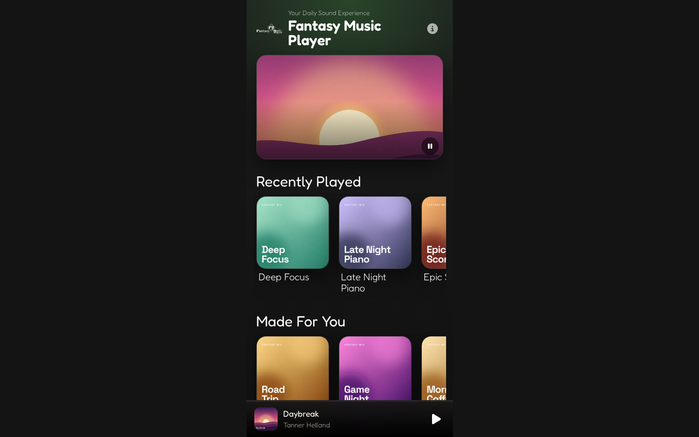

<a id="top"></a>

<div align="center">

  

  <h1>🎧 Fantasy Music Player</h1>

  <h3>A mobile-first music app built with HTML, CSS, and vanilla JavaScript.</h3>

  <p>
    <a href="https://nitzanm23.github.io/fantasy-music-player/">
      
    </a>
  </p>

  <p>
    
    
    
    <a href="https://github.com/nitzanm23/fantasy-music-player/actions/workflows/ci.yml">
      
    </a>
  </p>

</div>

<p align="center">
  
</p>

---

## 🎯 Overview

**Fantasy Music Player** is a single-page music app designed for phones, built as a portfolio project with semantic HTML, modular CSS, and vanilla JavaScript. On larger screens it stays a phone-sized column, like a mobile app preview.

The original player follows the Modern Web music player tutorial credited below. I rebuilt it into a fuller app: a mini player that opens into a full-screen player, a playlist drawer, shuffle and repeat, lock-screen controls, saved settings, an About sheet, and home screen install.

> **Demo scope:** A static front end with eight openly licensed tracks by composer Tanner Helland and no backend, accounts, or search. The playlist cards on the home screen are sample content and show a short "demo only" message when tapped. All playback controls work.

---

## ✨ Features

- **Mini player and full-screen player:** A bar with cover, title, and play button stays at the bottom of the home screen. Tapping it opens the full player with seek bar, previous/next, shuffle, repeat, and volume.
- **Playlist drawer:** All tracks with the current one highlighted and an equalizer animation while it plays.
- **Lock-screen controls:** Title, artist, and cover appear on the phone's lock screen and notification, and its play, skip, and seek buttons control the app (Media Session API).
- **Remembers your settings:** The last track, shuffle, repeat, and volume are restored on the next visit.
- **Installs like an app:** A web app manifest and icons let it be added to the home screen and opened full screen, with safe-area support for notched phones.
- **About sheet:** App info, credits, and links to my portfolio, source code, and LinkedIn.

---

## 🧠 Technical Highlights

- **Event-driven playback:** One `<audio>` element is the single source of truth. The UI updates from its own events (`play`, `pause`, `timeupdate`, `ended`, `volumechange`) instead of a polling timer, so every view always matches.
- **Accessible views:** The player, drawer, and About sheet are real buttons with clear labels. Only the visible layer is reachable (`inert` on the layers behind it), focus moves into each view and returns to the control that opened it, and Escape closes them. The About sheet is a native `<dialog>`.
- **Clear button states:** Play/Pause is one button whose label changes with the state. Shuffle, repeat, and mute use `aria-pressed`, and an active mode shows a dot as well as a color.
- **Motion that respects people:** The featured slideshow has a pause button (WCAG 2.2.2), pauses on hover, and does not move at all with `prefers-reduced-motion`.
- **Original artwork:** Every cover, playlist tile, and featured banner was made for this project as a code-drawn SVG scene and exported to WebP (about 0.3 MB in total). The font is self-hosted, and the 17 icons ship as one SVG sprite instead of a full icon font.
- **Works without JavaScript:** The opening screen never blocks the page, and a short message replaces the play button.

---

## 🧰 Tech Stack

- **HTML5 & CSS3:** custom properties, BEM, Flexbox, Grid, `dvh` units, safe-area insets
- **Vanilla JavaScript:** Media Session API, `localStorage`, `<dialog>`, `inert`; no framework or build step
- **Fredoka:** self-hosted variable font in `vendor/fonts/`
- **Font Awesome Free 6.7.2:** 16 icons in one SVG sprite (`assets/icons/icons.svg`), plus one icon of my own
- **GitHub Actions:** HTML validation, Lighthouse CI, and GitHub Pages deployment

---

## 📁 Project Structure

```text
fantasy-music-player/
├── index.html
├── manifest.webmanifest  # home screen name, colors, and icons (install as an app)
├── assets/
│   ├── audio/            # eight tracks by Tanner Helland (MP3, CC BY 4.0)
│   ├── icons/            # favicon, home screen icons, icon sprite
│   ├── images/
│   │   ├── covers/       # track cover art
│   │   ├── featured/     # home screen slideshow banners
│   │   ├── playlists/    # playlist tiles
│   │   └── og-image.jpg  # social preview image
│   └── logos/
├── styles/
│   ├── tokens.css        # design tokens (colors, spacing, motion, layers)
│   ├── reset.css         # browser defaults, focus ring, reduced motion
│   ├── page-loader.css   # opening screen
│   └── index.css         # app layout and components
├── scripts/
│   ├── data.js           # track list
│   ├── app.js            # playback, views, slideshow, Media Session
│   ├── demo-notice.js    # "demo only" messages
│   └── page-loader.js    # opening screen (runs before first paint)
├── vendor/               # self-hosted font and license files
├── docs/                 # README screenshots, demo GIF, signatures
└── .github/              # CI workflow, html-validate and Lighthouse settings
```

---

## 🚀 Getting Started

### Run locally

Clone the repository, open a terminal in the project folder, and start a static server:

```bash
npx http-server -c-1
```

Then open the address it prints (usually `http://localhost:8080`). Use a server that supports HTTP range requests, like this one or GitHub Pages: Python's `http.server` does not, so the seek bar jumps back to the start there. Opening the file directly (`file://`) breaks the icons in Chromium-based browsers, which block external SVG sprites there.

### CI & deployment

Every push and pull request runs [`ci.yml`](.github/workflows/ci.yml): `html-validate` checks the page, and Lighthouse CI fails the run if Accessibility, Best Practices, or SEO drop below 95. Pushes to `main` that pass are deployed to GitHub Pages, publishing only the runtime files.

### Testing

Checked in Chrome at 320, 360, 390, 768, and 1440px with touch emulation on the phone sizes, plus keyboard-only use, reduced motion, and JavaScript disabled. Results: no console errors or horizontal overflow, 0 axe-core WCAG A/AA violations on the home screen, full-screen player, playlist, and About sheet, and Lighthouse scores of 100 for Accessibility, Best Practices, and SEO on mobile and desktop.

---

## 📸 Screenshots

<table>
  <tr>
    <td width="25%" valign="top"></td>
    <td width="25%" valign="top"></td>
    <td width="25%" valign="top"></td>
    <td width="25%" valign="top"></td>
  </tr>
</table>

<details>
  <summary>Desktop view</summary>
  <br />
  
</details>

---

## 🔭 Possible Improvements

- Add a service worker to cache the app and recently played tracks for offline listening.
- Turn the home screen playlists into real, data-driven playlists with their own track lists.
- Add a search screen that filters the track list by title and artist.

---

## 🙏 Credits & License

- **Tutorial:** [How to create Music player with pure HTML, CSS, JS](https://dev.to/kunaal438/how-to-create-music-player-with-pure-html-css-js-34lc) by kunaal438 (Modern Web).
- **Music:** All eight tracks are by [Tanner Helland](https://github.com/tannerhelland/free-music), licensed under [CC BY 4.0](https://creativecommons.org/licenses/by/4.0/). The files are used unchanged and renamed to match the track titles: _Daybreak_, _A Memory Away_, _The Forest Awakes_, _From Here_, _Syntheticity_, _Destiny_, _Familiar Roads_, and _Lost Islands_.
- **Artwork:** The track covers, playlist tiles, and featured banners are original artwork made for this project. Playlist names are sample content.
- **Libraries & fonts:** Fredoka (OFL 1.1) and Font Awesome Free icons (CC BY 4.0). License files are in `vendor/`.
- **License:** My own code is released under the [MIT License](LICENSE). Third-party assets above keep their own terms.

---

## 👤 About Me

<div align="center">

  <h3>NM Dev · Nitzan Mizrachi</h3>

  <p>
    <a href="https://nm-dev.com">
      
    </a>
    <a href="https://www.linkedin.com/in/nitzan-mizrachi/">
      
    </a>
    <a href="mailto:nitzanm23@gmail.com">
      
    </a>
    <a href="https://github.com/nitzanm23">
      
    </a>
  </p>

  <table align="center">
    <tr>
      <td align="center">
        
      </td>
      <td align="center">
        
      </td>
    </tr>
  </table>

  <p><a href="#top">⬆ Back to top</a></p>

</div>
